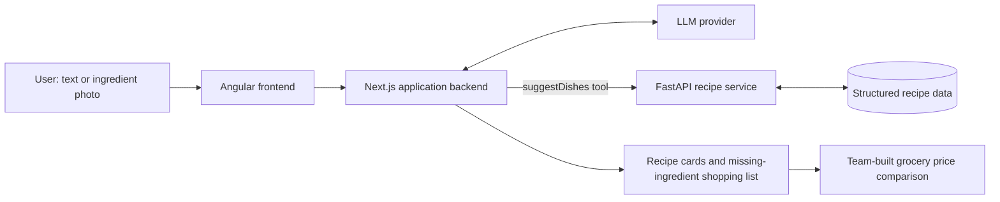

# From Fridge to Shopping List — LLM Recipe Assistant

**An LLM-powered application that turns available ingredients into database-grounded recipe suggestions and shopping lists.** Users can describe what is in their kitchen or upload an ingredient photo, select recipes, and compare grocery prices through the team-built interface.

> **Portfolio context:** This is my fork of a **three-person team project**. My individual work focused on the **recipe data pipeline, FastAPI recommendation engine, LLM tool integration, and Docker integration**. The frontend, shopping/price comparison, and later ontology-matching enhancements were collaborative or implemented by other team members.

## At a glance

| Data pipeline (my work) | Recipe engine (my work) | Integrated application (team result) |
|:--|:--|:--|
| **13,480** structured recipes | **2 REST endpoints**: `/recommend`, `/missing` | **92.5% Hit@5** with ontology matching vs. **57.5%** with exact matching in a 200-recipe evaluation |
| **148,854** ingredient lines | Coverage-based scoring and ranked results | Text/image-to-recipe-to-shopping-list flow |
| **151,011** quantity records | Python · FastAPI · pandas | Angular · Next.js · LLM tool calling · PostgreSQL · Docker Compose |

The dataset export contained **145,868 ingredient lines with successfully parsed names (about 98.0%)**. Parsing status does not guarantee that every amount or unit was extracted correctly; the pipeline also identifies cases for manual review.

## What I built

| Area | My implementation | Source |
|---|---|---|
| Data preparation | Cleaned the source recipes; repaired malformed ingredient lists; extracted names, amounts, units, preparations, and comments; added parser fallbacks and QA outputs. | [`preprocess_recipes.py`](recipe-service/scripts/preprocess_recipes.py) · [`Data pipeline`](docs/data-pipeline.md) |
| FastAPI recipe service | Implemented recipe recommendation and missing-ingredient endpoints with validated request models. | [`main.py`](recipe-service/app/main.py) |
| Recipe matching and ranking | Implemented ingredient normalization, matched/missing sets, filtering, coverage and ingredient-usage scoring. | [`recipe_service.py`](recipe-service/app/recipe_service.py) · [`ingredient_matcher.py`](recipe-service/app/ingredient_matcher.py) |
| LLM tool integration | Connected recipe retrieval to the application's tool-calling workflow, grounding suggested dishes in the structured recipe database. | [`tools.ts`](backend/src/lib/tools.ts) · [`recipe-service.ts`](backend/src/lib/recipe-service.ts) |
| Containerization | Added the recipe-service Dockerfile, wired the service into Docker Compose, and ran the integrated application locally. | [`Dockerfile`](recipe-service/Dockerfile) · [`compose.yaml`](compose.yaml) |

**Contribution evidence:** [My original recipe-service and LLM integration commit](https://github.com/D11bot/recipe-chatbot/commit/4f8d0f0d1241aa4155e6ee6b404688c0d9989d67) · [My development branch](https://github.com/D11bot/recipe-chatbot/tree/dan-recipe-integration). Later team changes, including the Open Food Facts ontology matcher, are present in this portfolio branch but are **not claimed as my sole implementation**.

## How the system works



The LLM handles natural-language understanding and visual ingredient identification. **Recipe retrieval and ingredient coverage are handled by deterministic application code**, so suggested recipes can be grounded in the dataset instead of being invented by the model.

The recipe recommender uses two signals:

`recommendation_score = 0.6 × ingredient_coverage + 0.4 × available_ingredient_usage`

Results are filtered by minimum matches, minimum coverage and a maximum number of missing ingredients, then ranked by score. The separate `/missing` endpoint returns matched and missing ingredients for a selected recipe.

## Outcomes and evaluation

**Recipe retrieval (integrated team's evaluation):** On **200 selected recipes**, both matchers received the same LLM-rewritten ingredient lists. This experiment compares the original exact-name baseline with the later ontology-based extension:

| Metric | Exact matching | Ontology matching |
|---|---:|---:|
| **Hit@1** | 50.0% | 84.5% |
| **Hit@5** | **57.5%** | **92.5%** |
| **MRR@10** | 0.535 | 0.879 |
| No recommendation returned | 2.5% | 0% |
| Mean request time | 37 ms | 41 ms |

The ontology matcher and its evaluation are **team-level results**. The evaluation uses selected recipes and paraphrased ingredient lists, rather than naturally occurring users with arbitrary missing and extra ingredients. The experiment code is available in [`eval/run_matcher_test.py`](eval/run_matcher_test.py).

**Image ingredient identification (small team test):** On **20 hand-selected fruit/vegetable photos**, mean recall was **97.5%** and mean precision was **96.3%** against the evaluated dataset classes. This is a limited proof of concept, **not** a benchmark on real refrigerator images. The test harness is in [`eval/run_photo_test.py`](eval/run_photo_test.py).

## Run locally

**Requirements:** Docker with Compose and an API key for a supported LLM provider. For the full dataset, download the original source separately; for a quick API demo, you can generate a small synthetic dataset instead.

### 1. Prepare the recipe data

**Quick demo (8 synthetic recipes; no dataset download required):**

```bash
python -m pip install -r recipe-service/requirements-data.txt
python recipe-service/scripts/make_demo_data.py
```

These synthetic recipes support a smoke test of recommendation and missing-ingredient endpoints. **Do not use them to reproduce the results above.** The command refuses to overwrite existing CSVs.

**Full dataset:**

Download the **Food Ingredients and Recipe Dataset with Images** from [Kaggle](https://www.kaggle.com/datasets/pes12017000148/food-ingredients-and-recipe-dataset-with-images), following its access and reuse terms. Place the source CSV at `recipe-service/data/raw/13k-recipes.csv`. It should contain the source fields `Title`, `Ingredients`, `Instructions`, `Image_Name`, and `Cleaned_Ingredients`.

```bash
python -m pip install -r recipe-service/requirements-data.txt
python recipe-service/scripts/preprocess_recipes.py
```

This generates `recipe-service/data/processed/recipes.csv`, `recipe_ingredients.csv`, `ingredient_amounts.csv`, plus QA review files. See the [data-pipeline documentation](docs/data-pipeline.md). The historical counts above are reference results; rerunning may yield different parsing classifications if the upstream NLP parser version changes.

### 2. Configure the LLM

Copy `.env.example` to `.env`, choose `LLM_PROVIDER=gemini` or `openrouter`, and set the corresponding API key. Do not commit `.env`.

### 3. Start the application

```bash
docker compose up --build
```

- **Web app:** http://localhost:4300
- **FastAPI documentation:** http://localhost:8000/docs
- **Recipe service health:** http://localhost:8000/health

The app uses Docker Compose to start the frontend, backend, PostgreSQL database and Python recipe service. The backend waits for the recipe service health check.

### Try the recipe API

```bash
curl -X POST http://localhost:8000/recommend \
  -H 'Content-Type: application/json' \
  -d '{"available_ingredients":["tomato","egg","onion","olive oil","garlic"],"top_k":3}'
```

The returned recipes depend on the prepared dataset and active matcher.

## Tests

Install development dependencies first (`python -m pip install -r recipe-service/requirements-dev.txt`).

```bash
python -m pytest recipe-service/tests -q            # data cleaning and synthetic-data checks
(cd recipe-service/app && python -m unittest test_ontology)  # ontology behavior
(cd backend && npm test)                             # backend tests
```

The recipe service supports `RECIPE_MATCHER=exact` or `RECIPE_MATCHER=ontology` (the latter is the default in Compose). See [`recipe-service/scripts/compare_matchers.py`](recipe-service/scripts/compare_matchers.py) for a small interactive comparison.

## Scope and limitations

- This is a **portfolio fork of collaborative software**, not a claim of sole authorship. The shopping UI, store integration and later ontology extension are team work.
- Recipe content reflects the source dataset and may not cover all cuisines or ingredients available in Sweden.
- The image evaluation is small and does not establish reliability for allergy-sensitive decisions.
- External LLM providers and store websites may change. Price comparisons should not be interpreted as guaranteed current prices.
- The raw recipe dataset and full processed CSV exports are **not bundled here**; generate synthetic demo records or prepare the full data before running Docker.

---

**My engineering focus:** **Python · Data Engineering · FastAPI · REST APIs · Ingredient Matching · Recommendation Ranking · LLM Tool Integration · Docker Compose**
